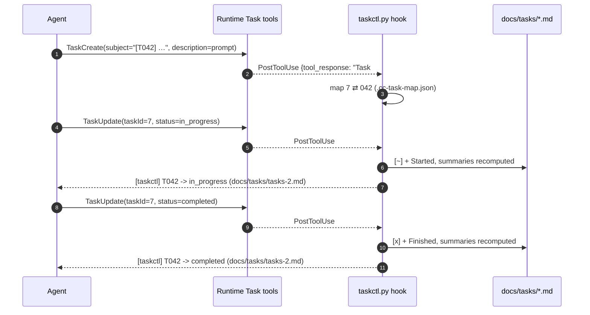

# scripts/tasks — `taskctl.py`

Bridge between the file-based task workflow (`docs/tasks/`, rule [`rules/001-tasks-workflow.mdc`](../../rules/001-tasks-workflow.mdc)) and the agent runtime's native Task tools (Claude Code / Claude Desktop: `TaskCreate`, `TaskUpdate`, legacy `TodoWrite`).

- **Files are the source of truth** — full User Story / Acceptance Criteria, versioned in git.
- **Runtime Task list is a live mirror** — progress UI, navigation in the web/cloud session.
- **Bridge key** — Task ID in the file (`042`) ⇄ `[T042]` prefix in the runtime task subject (or `metadata.task_ref`).

Python ≥ 3.10, stdlib only. Windows (Git Bash / PowerShell) + Linux.

## Install

Run once per project, from the parent project root:

```bash
.agents/zuko-ai-rules/scripts/install-excludes.sh            # asks: install hooks? → scope project|local|user
.agents/zuko-ai-rules/scripts/install-excludes.sh --tasks-hooks yes --hooks-scope local   # non-interactive
```

It writes `hooks.PostToolUse` + `hooks.SessionStart` + `env.CLAUDE_CODE_ENABLE_TODO_TOOLS=1` into the chosen settings file, idempotently. Nothing else in the settings file is touched.

## Active mode — the agent calls the CLI

```bash
T="python .agents/zuko-ai-rules/scripts/tasks/taskctl.py"   # run from the project root, or add --root <dir>

$T next [--json]           # first [~], else first [ ] (index order); --json includes the full prompt + cc_subject
$T show <ID> [--json]      # ID accepts 42 / 042 / T042 / 002-1
$T list [--status pending|in_progress|completed|all] [--json]
$T start <ID>              # [ ] -> [~] + Started, then recompute summaries
$T finish <ID>             # -> [x] + Finished, then recompute summaries
$T reopen <ID>             # -> [ ], timestamps removed
$T sync-index              # recompute every local Summary, the Overall summary and the Task File Index
$T validate [--json]       # file:line list of what the CLI/hook cannot read; exit 1 on errors
```

JSON fields: `ref, title, file, status, tasks_file, started, finished, cc_subject` (+ `prompt` for `next`/`show`).
`cc_subject` is ready to pass as `TaskCreate.subject`.

`validate` runs on every load. Errors (malformed `### Task ID:` header, missing Title/File/Complete, bad checkbox, unclosed or 3-inside-3 nested fence, duplicate ID) make `start`/`finish`/`reopen` refuse that file and `sync-index` refuse entirely; `list`/`next`/`show` still answer but warn on stderr. Warnings (`[~]` without Started, out-of-order IDs, stale map entries, missing index) never block.

## Passive mode — the runtime invokes the hook

The agent never calls this. Claude Code runs it after `TaskCreate` / `TaskUpdate` / `TodoWrite` (stdin JSON → stdout JSON) and injects the result into the agent's context as `[taskctl] ...`.



| Event | What the hook does |
|---|---|
| `TaskCreate` | ref from `metadata.task_ref` or `[T042]` subject prefix; runtime id from `tool_response` (`task.id` or `Task #7` text) → `docs/tasks/.cc-task-map.json` |
| `TaskUpdate` | ref via the map (or `metadata.task_ref`); `in_progress`→start, `completed`→finish, `pending`→reopen, `deleted`→unmap only |
| `TodoWrite` | every todo whose `content` starts with `[T042]` → same mapping |
| `SessionStart` | injects counts + open `[~]` tasks + the next task with its `cc_subject` |

Always exits `0`; never blocks the agent. Silent when the project has no `docs/tasks/` (safe at user scope). Unrelated runtime tasks (no `[T…]` prefix) are ignored. If validation errors exist, the hook reports them in the same `[taskctl]` line instead of touching the file.

`docs/tasks/.cc-task-map.json` (runtime id ⇄ Task ID) lives next to the task files and follows `docs/tasks/`' git status — tracked if the directory is tracked.

## Notes

- Newer models (Opus 4.8 / Sonnet 5 / Fable 5 / Mythos 5) get the Task tools only with `CLAUDE_CODE_ENABLE_TODO_TOOLS=1` — the installer sets it. `CLAUDE_CODE_ENABLE_TASKS=0` switches the runtime to `TodoWrite`; also handled.
- Windows: Claude Code runs hooks in Git Bash; the installer picks the first interpreter that really runs (`python3` Store alias is skipped).
- Claude Desktop / Cowork: Active mode works as-is; hook support there is unverified — the rule's fallback (`start`/`finish`) covers it.

## Test

```bash
bash scripts/tasks/tests/make_fixture.sh /tmp/fixture
echo '{"cwd":"/tmp/fixture","tool_name":"TaskCreate","tool_input":{"subject":"[T002] Add CLI entry"},"tool_response":"Task #7 created successfully"}' | python scripts/tasks/taskctl.py hook
echo '{"cwd":"/tmp/fixture","tool_name":"TaskUpdate","tool_input":{"taskId":"7","status":"completed"}}' | python scripts/tasks/taskctl.py hook
python scripts/tasks/taskctl.py --root /tmp/fixture list
```
